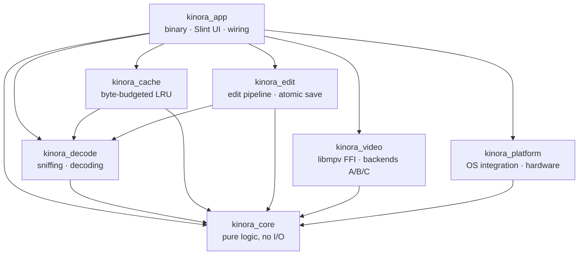
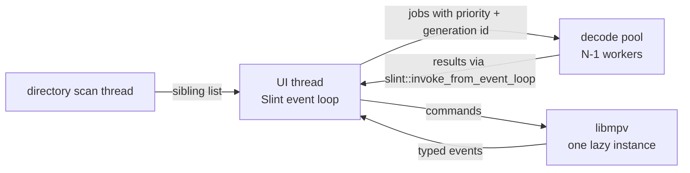

# Kinora architecture

> Phase 0 snapshot: the crates exist, but only `kinora_app` contains code so far (an empty window).
> The threading and data flow below is the **design** from PROJECT_BRIEF.md §7, and is filled in phase by phase.

## Crates

Rules: `kinora_core` depends on no other Kinora crate, and there are no cycles. Platform-specific code lives only in `kinora_platform`, plus the GL parts of `kinora_video`. `unsafe` is allowed only in those two crates. The arrows between library crates are planned and get added as real code needs them.

## Threading model (planned)

- The UI thread never blocks on disk, decoding or mpv.
- When the user navigates, stale decode jobs are dropped before they start (by generation id).
- Pool sizes, cache budgets and preload distances all come from the hardware profile (Lite/Typical/High).
