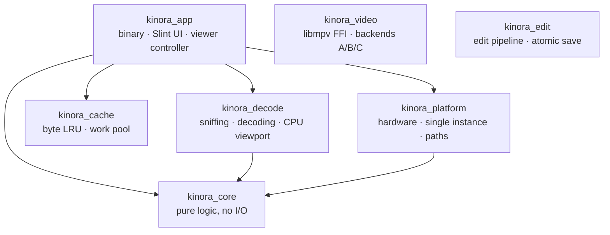
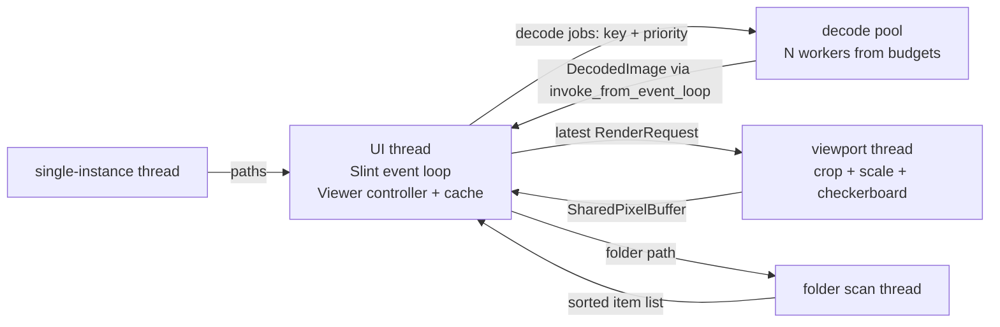

# Kinora architecture

> Phase 2 snapshot: the image viewer works end to end. Video (`kinora_video`) arrives in Phase 3, editing (`kinora_edit`) in Phase 6; those crates are still empty.

## Crates

Rules: `kinora_core` depends on no other Kinora crate, and there are no cycles. Platform-specific code lives only in `kinora_platform` (and, from Phase 3, the GL parts of `kinora_video`). `unsafe` is allowed only in those two crates, in named modules with a `// SAFETY:` comment per block.

| Crate | What's in it (Phase 2) |
|---|---|
| `kinora_core` | `natural_sort`, `folder` (items, sort keys, current item), `navigation` (next/prev/home/end, wrap, direction, generation), `preload` (direction-aware plan), `viewport` (fit/zoom/pan maths in physical pixels), `hardware` (tiers, budgets), `settings` (TOML model) |
| `kinora_decode` | `format` (sniffing + extension fallback), decoders (`image`, `jpeg-decoder` scaled, `avif-decode`/rav1d, libheif, `jxl-oxide`, `resvg`), EXIF orientation + thumbnail, ICC → sRGB, HDR tone mapping, `viewport` (CPU viewport renderer, pyramid) |
| `kinora_cache` | `ByteLru` (byte budget, pinning), `WorkPool` (priorities, re-ranking/cancellation, panic isolation) |
| `kinora_platform` | `hardware::probe` (cores incl. affinity, RAM, AVX2, GPU via DXGI / Mesa hints), `single_instance`, `paths`, `fs::atomic_write`, `memory`, `gl::renderer_name`, `library_available` (delay-loaded `heif.dll`) |
| `kinora_app` | `main` (startup order), `startup` (renderer + Lite choice), `cli`, `logging`, `settings_store`, `viewer/` (controller, jobs, render thread, folder scan, key mapping), `ui/*.slint` |

## Startup (brief §7.6)

1. Parse the command line; start logging (stderr + daily file in the OS log folder).
2. Load `settings.toml`. **Single instance:** if another Kinora runs, send it the file and exit (~100 ms).
3. **Hardware probe** (~12–16 ms): cores, RAM, GPU → tier (Lite/Typical/High). `KINORA_SIMULATE=lite` simulates a Lite PC.
4. Choose the renderer (command line → settings → automatic) and Lite mode; compute budgets (workers, cache, preload distance, largest decode).
5. Select Slint's winit backend, create the window, start the viewer, **submit the first decode** — it runs while the native window is being created.
6. Folder scan on its own thread; the list fills in after the opened file is already showing.

## Threads and data flow

- **The UI thread never decodes or scales.** It owns the controller (`Rc<RefCell<State>>`, learning note 12): folder model, navigator, the byte-budgeted cache, the current view.
- **Decoding:** each job is keyed by *(path, quality)* — `Screen` (enough for "fit" on this monitor; DCT-scaled for JPEG) or `Full` (requested only when zooming past the screen-sized version). On every navigation the viewer re-ranks the queue: the current picture gets priority 0, neighbours 1, 2, 3… (direction-aware, from the hardware budgets); everything else is dropped before it starts. Results the UI no longer needs still go into the cache.
- **In Lite mode** the job for the picture on screen first delivers the JPEG's embedded EXIF thumbnail, then the real picture.
- **Viewport rendering (ADR 0004):** the render thread takes the newest request only ("latest wins"), resamples from the smallest suitable pyramid level, caches the whole picture at the current zoom when that is at most 4 windows big (so panning is a crop), and composites a checkerboard behind transparency. The result is drawn 1:1 in physical pixels by every Slint renderer.
- **Cache:** `ByteLru` keeps decoded pictures within the budget (Lite: 10% of RAM, 64–256 MB; otherwise ≤ min(512 MB, 15% of RAM)); the current picture is pinned.
- **Animations** (GIF/WebP/APNG): all frames are decoded up to a memory cap; a UI timer advances frames, each frame goes through the viewport thread.

## Failure handling
Every decoder runs inside `catch_unwind`; damaged, empty, unknown or oversized files become typed `DecodeError`s and an error card. HEIF/AVIF containers are checked for completeness first. On Windows `heif.dll` is delay-loaded and probed before first use. Video files show a "not yet" card until Phase 3.
